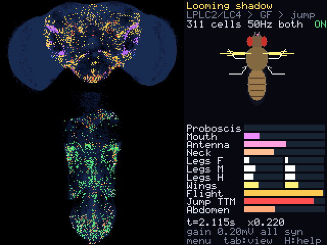
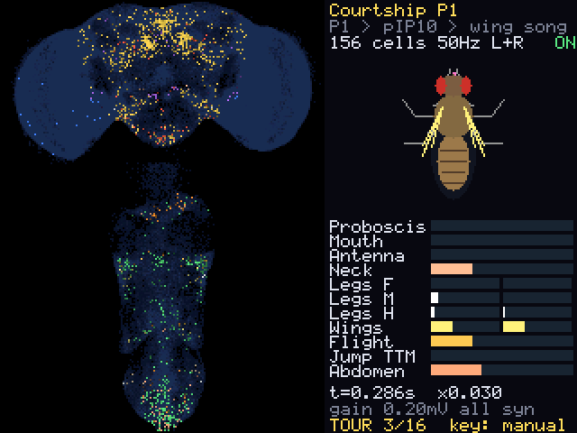

# A whole fruit fly nervous system on a TI-Nspire CX II

This project puts the complete connectome of the adult male *Drosophila*
central nervous system (brain and ventral nerve cord) on a graphing
calculator and runs it as a spiking neural network that you can poke.

| | |
|---|---|
| Neurons | 166,700 |
| Connections (neuron pairs) | 25,582,938, no synapse-count threshold |
| Synapses | 124,177,617 |
| Source | Janelia FlyEM male CNS connectome v1.0 (CC-BY) |
| Calculator files | 32.2 MB (30.9 MB of connections, entropy coded) |
| Model | leaky integrate-and-fire after Shiu et al. 2024, 1 ms integer steps |



*Host render of the calculator screen (same C code, same data). Left: one
dot per neuron, brain in front view above the nerve cord in top view. Right:
the fly's motor neuron pools and a cartoon they drive. Figures in this
document are from the host build unless they say otherwise.*

## On the real calculator



*A frame the calculator saved while running (TI-Nspire CX II, OS 6.2.0.333,
Ndless r2023, build 1.6): P1 courtship neurons stimulated, 286 ms into the
simulation, wing and abdominal motor pools firing and the cartoon's wings
out. The other fifteen experiments are in `docs/img/device/`.*

Everything in this section was measured on the handheld. Logs of all five
runs are in `docs/device-run*-log.txt`; figures are from run 5 (build 1.6,
the current source) unless they say otherwise.

| | |
|---|---|
| Data files | copied over USB and read back byte-identical |
| Load time | 13.2 s |
| Edge data kept in RAM | 19.5 of 30.9 MB (the rest is paged from flash) |
| Page-in from flash | 21 to 35 ms per block when probed in ascending or descending file order, 93 ms in scattered order; 92 page-ins over a tour of all 16 experiments, 83 ms each on average |
| Boot self-check | spike trains identical to the host's, bit for bit (260 steps, 2.9 M synaptic events, 3.4 s) |
| Drawing a frame | 8 ms |
| A step with nothing active | 0.01 ms |

The self-check matters most: it shows that this calculator, with 37% of the
connection data on flash, computes the same spikes as the reference
implementation on the computer.

### Speed

Simulated milliseconds per second of wall time, from the automatic tour
(9 s per experiment), for the last three builds:

| Experiment | Build 1.4 | Build 1.5 | Build 1.6 | Synaptic events per second (1.6) |
|---|---|---|---|---|
| Giant fibre | 111 | 242 (capped) | 988 (capped) | 295,000 |
| Compass EPG | 173 | 242 (capped) | 681 | 964,000 |
| Song cmd pIP10 | 84 | 231 (capped) | 376 | 798,000 |
| Bitter taste | 53 | 209 | 277 | 678,000 |
| Sound | 51 | 203 | 261 | 569,000 |
| Female pheromone | 52 | 219 | 239 | 725,000 |
| Lick cmd aSP22 | 28 | 118 | 132 | 654,000 |
| Moonwalker MDN | 24 | 76 | 79 | 675,000 |
| Wing load sensors | 24 | 68 | 70 | 836,000 |
| Chase LC10a | 17 | 54 | 55 | 831,000 |
| Sugar on tongue | 15 | 39 | 42 | 581,000 |
| Courtship P1 | 14 | 29 | 32 | 831,000 |
| Groom cmd aDN1 | 12 | 17 | 20 | 824,000 |
| Looming shadow | 11 | 19 | 19 | 892,000 |
| Dust on eyes | 11 | 18 | 19 | 845,000 |
| Optic flow | 10 | 10 | 15 | 706,000 |

1000 would be real time. So the giant fibre circuit runs in real time, the
compass at two thirds of it, and the experiments that recruit tens of
thousands of neurons at 1.5 to 5.5%: a response that takes the fly 100 ms
takes the calculator between 0.1 and 7 seconds. "Capped" means the program
was holding the simulation to its speed limit (a quarter of real time in
1.5, real time in 1.6). The first stop of the tour, sugar, is under-reported
in every build: its 9 s include about 1.7 s of the boot screen, so the true
figure for 1.6 is about 52.

Do not read the 1.4 column against the others as pure program speed. The
handheld's CPU itself was about 1.35 times slower in run 3 (build 1.4) than
in runs 4 and 5: the unchanged decode benchmark took 618 ms there and 458
and 445 ms later. I do not know why (same calculator, same data files).

Where the time goes in build 1.6, summed over the tour, from a stopwatch
inside the simulator:

| | Share of wall time | Unit cost |
|---|---|---|
| Decoding and delivering synaptic events | 57% | 0.76 µs per event |
| Replaying missed steps for neurons that were left alone | 23% (estimate) | 81 ns per neuron-step |
| Drawing | 7% | 8 ms per frame |
| Reading edge blocks from flash | 5% | 83 ms per block |
| Stimulus and stepping the neurons near threshold | 2% | |
| Everything else (keys, readouts, log) | 6% | |

Delivery as a whole and the flash reads inside it were timed directly. The
replay share is the number of replayed steps the program counted, priced at
the unit cost from the on-device benchmark, and the per-event cost is what
is left of delivery after subtracting it; that came out between 0.73 and
0.83 µs in all sixteen experiments. It is mostly one memory access: the CPU
is an ARM9 with an 8 KB data cache,
a neuron's state is almost never in it, and fetching a cache line from RAM
takes about 0.3 µs, on the order of a hundred instructions.

What changed between builds. 1.4 integrated every neuron with non-zero state
on every step, and that pass took most of its time. 1.5 only steps neurons
that could reach threshold and catches the others up when they are next
touched (see "Simulation" below); it also made the neuron state 1 MB larger,
which pushed 1 MB of edge data out of RAM and quadrupled the page-ins. 1.6
gives that memory back by leaving 1.25 MB instead of 2 MB to the operating
system (1.7 MB was actually free while it ran), finds the active neurons
through a two-level bitmap so that a quiet step costs 0.01 ms instead of
0.55, and raises the default speed limit to real time.

Practical notes: Ndless is not persistent, so it has to be reinstalled after
a calculator reset. USB does not work while the program runs; unplug and
replug the cable after quitting to reach the calculator again. Two small
defects are known and left in, because the source is exactly the build that
was measured: the first tour stop is 1.7 s short (above), and the bottom
status line loses its last character when the tour counter has two digits.

## What you can do with it

You stimulate a population of neurons and watch activity spread through the
real wiring, from sensory neurons through the brain, down the neck and out
to motor neurons. Sixteen experiments are built in, and you can type the
name of any of the 11,751 annotated cell types to stimulate or silence it.

| Key | Action |
|---|---|
| up / down | previous / next experiment |
| menu | experiment list |
| left / right | stimulus rate |
| enter | stimulus on / off |
| S | stimulate both sides / left / right |
| T | stimulate any cell type (type to search, also by literature name) |
| X | silence a cell type (toggle) |
| + / - | synaptic gain |
| × / ÷ | playback speed limit (starts at real time) |
| W | single-synapse connections on / off |
| tab | fly view / activity view / system view |
| P, R, A | pause, reset, automatic tour |
| esc | quit |

On start it tours the experiments by itself until you press a key.

## What the model does with the connectome

Each row is a built-in experiment at the default gain: what is stimulated,
and what the network does one or two simulated seconds later. Nothing
downstream of the stimulated cells is scripted. Rates come from
`python -m pipeline.report`.

| Experiment | Stimulated | Result in the model |
|---|---|---|
| Sugar on tongue | 77 labellar taste neurons (LB3a-d) | proboscis motor neuron MN9 at 66 Hz; relays GNG038, GNG042, GNG175, GNG229 (annotated Specter, Quasimodo, Usnea, Phantom after Shiu 2022) |
| Looming shadow | LPLC2 and LC4 visual neurons | giant fibre DNp01 at 300 Hz, jump motor neuron TTMn at 65 Hz, flight power motor neurons at 100 Hz |
| Courtship P1 | 156 pC1 neurons | song command pIP10, then wing motor neurons at about 20 Hz and abdominal motor neurons |
| Song cmd pIP10 | 2 neurons | vPR9, vMS12, dMS9, then wing motor neurons hg3, hg4, ps1 |
| Lick cmd aSP22 | 2 neurons | MN9 at 38 Hz |
| Moonwalker MDN | 4 neurons | LBL40 at 96 Hz, hind and mid leg motor neurons |
| Groom cmd aDN1 | 2 neurons | antennal motor neurons at 61 Hz, both front legs at about 18 Hz |
| Dust on eyes | 745 eye bristle neurons | same antennal and front leg pools via the sensory route |
| Optic flow | 3,348 T4a/T5a motion detectors | HSN, HSE, HSS, DCH, VCH saturate; neck motor neurons |
| Compass EPG | 46 neurons | ring neurons ExR6, ER6, ExR4 and Delta7; 125 cells active in total |
| Chase LC10a | 275 neurons | AOTU019 at 248 Hz, TuTuA |
| Female pheromone | 147 foreleg taste neurons | AN05B102a/b (annotated PPN1 after Kallman 2015) |
| Wing load sensors | 426 campaniform sensilla | b1 wing steering motor neuron at 126 Hz |
| Bitter taste | 57 labellar neurons (LB1) | GNG087 (annotated Scapula after Shiu 2022), GNG016 |
| Sound | 138 Johnston's organ neurons | SAD and WED auditory neurons |
| Giant fibre | 2 neurons at 200 Hz | TTMn at 26 Hz, 35 cells active in total |

Several of these match pathways described in the literature (sugar to MN9,
looming to giant fibre to TTMn, P1 to pIP10 to song, MDN to LBL40, aDN1 to
antennal grooming, T4a/T5a to HS cells, campaniform to b1). That is evidence
the pipeline carries the wiring through intact. It is not a validation of
the neuron model.

## How it fits

**Ordering.** Neurons are renumbered by recursive graph bisection so that
each neuron's targets sit close together. This takes the mean log2 target
gap from 7.5 bits (original order) to 3.0.

**Coding.** Each neuron's outgoing connections are stored as target gaps
plus synapse counts, bucketed and Huffman coded with codes short enough for
a one-lookup decode. Connections with two or more synapses (15.3 M, 92% of
synapses, 19.9 MB) and single-synapse contacts (10.3 M, 11.0 MB) are
separate files. A plain 8-byte-per-edge table would be 205 MB.

**Memory.** The handheld has about 32 MB of free RAM and the edge data is
30.9 MB, so not everything can be resident. Edge data is split into blocks
of 64 neurons. Blocks are ranked by how often the built-in experiments need
them per byte, the best ones are pinned in RAM, and the rest are paged in
from flash on demand into a two-generation cache. On the host build with a
24 MB arena (19.6 of 29.5 MiB resident), the sixteen built-in experiments
need 17 page-ins between them over one simulated second each; at 20 MB it is
975. The handheld gives the program 21.5 MB for this, which keeps 19.5 MB of
edge data resident.

**Simulation.** Event driven: when a neuron spikes, its connection list is
decoded and added to the targets two steps later. All arithmetic is 32-bit
integer.

In the busier experiments a third to two thirds of all neurons hold some
small residue of input at any moment, and stepping each of them every
millisecond is what the first calculator builds spent most of their time
on. Most of those neurons cannot
reach threshold unless more input arrives: with membrane potential v and
synaptic drive g, v can never rise above max(v, 0) + max(g, 0)/4 on its own
(this holds exactly for the integer arithmetic used, rounding included; the
proof is next to `may_fire` in `core/flysim.c`). Such a neuron is left
alone. It records the step its state belongs to, and whatever touches it
next first replays the steps it missed. Only the neurons that are near
threshold or inside a spike are stepped every time: between a few dozen and
two thousand in the built-in experiments. The result is the same spike
train, bit for bit: the Python reference model steps every neuron every
time, and the tests compare the two.

## The model, and where it departs from Shiu et al.

Dynamics, reset rule, refractory period, delay and time constants follow
Shiu et al. 2024 (*A Drosophila computational brain model reveals
sensorimotor processing*, Nature) and their published Brian2 code:
`dv/dt = (g - v)/20 ms`, `dg/dt = -g/5 ms`, threshold 7 mV above rest,
reset of both v and g, 2.2 ms refractory, 1.8 ms delay, weight = synapse
count times a sign.

Departures, all deliberate:

1. **Step size.** 1 ms fixed point instead of 0.1 ms floating point; delay
   and refractory period are both 2 steps.
2. **Gain.** 0.20 mV per synapse instead of 0.275. The male CNS
   reconstruction has about twice the synapses per neuron of the FlyWire
   data they used, and at 0.275 several experiments run away.
3. **Modulatory transmitters.** Neurons predicted dopaminergic,
   octopaminergic or serotonergic spike but have no fast synaptic effect.
4. **No transmitter consensus.** Where the dataset's consensus prediction is
   "unclear" the sign is not guessed: no effect, except sensory afferents,
   which are treated as cholinergic. This is 1.7% of neurons.
5. **Stimulation.** Stimulated neurons are forced to spike at Poisson-like
   times with a 3 ms dead time, with the probability corrected so the mean
   rate is the requested one.

Signs otherwise: acetylcholine excites; GABA, glutamate and histamine
inhibit.

## What has been checked

- **The data on the calculator is the connectome.** Tests decode rows from
  the packed files with the calculator's C decoder and compare them with the
  source graph, and check the totals above.
- **The C core is bit-exact with an independent Python implementation**
  (`pipeline/intsim.py`): identical spike-train hashes on the full
  connectome, with and without memory pressure, with the weak tier
  disabled, and with gain, silencing and stimulus rate changed in the
  middle of a run. The Python model integrates every neuron on every step,
  so this also checks the calculator's shortcut of skipping neurons that
  cannot fire. The host build runs under AddressSanitizer and UBSan.
- **Corrupt files cannot crash it.** Tests feed truncated and garbled
  metadata and edge data to the sanitizer build.
- **The 1 ms integer step is a small approximation.** Per-cell-type firing
  rates against a 0.1 ms floating-point reference correlate at r = 0.91 to
  0.999 (log rates) in 15 of 16 experiments, about the same as two reference
  runs with different random seeds (0.94 to 0.999). The exception is "Female
  pheromone", where the reference recruits about nine times more cells than
  the calculator model (r = 0.48). Numbers: `docs/validation.json`.
- **The calculator checks itself at boot**: it runs two short experiments
  and compares the spike-train hash with the value computed on the host.
  On the handheld this passes (see above).

`make test` runs 171 tests; `make coverage` reports 92% line coverage of
`pipeline/`.

## Limits

- This is a network of identical point neurons on real wiring. There are no
  gap junctions, no neuromodulation, no graded (non-spiking) transmission,
  no synaptic plasticity and no muscles or body. The giant fibre to TTMn
  connection, for example, is largely electrical in the animal.
- Transmitter identity is a per-neuron prediction and the sign of glutamate
  is assumed.
- Olfactory, thermosensory and mushroom body input makes the antennal lobe
  and Kenyon cells run away at the default gain (about 8,000 neurons near
  their maximum rate). The model has no presynaptic inhibition or other gain
  control there. No built-in experiment uses those inputs.
- Photoreceptors are histaminergic and therefore purely inhibitory here, so
  visual experiments start one or more synapses in (T4/T5, LC and LPLC
  neurons).
- The fly cartoon moves each body part in proportion to the firing of the
  motor neurons that innervate it. It is a readout, not a biomechanical
  simulation, and it does not show behaviour in any stronger sense.
- Raising the gain produces whole-network seizures. That is a property of
  this model class, not a finding about flies.

## Building it yourself

```bash
make data    # connectome -> build/calc/fly*.tns   (needs data/raw, see below)
make host    # C core + UI for the host, with sanitizer variants
make calc    # build/calc/drosophila.tns via the Ndless SDK
make test    # pytest: unit, integration and whole-connectome tests
```

The three source tables (1.1 GB) come from
`https://storage.googleapis.com/flyem-male-cns/v1.0/connectome-data/flat-connectome/`
and go in `data/raw/`; file names are in `pipeline/config.py`.

To run on a calculator you need a TI-Nspire CX II with Ndless installed
(a third-party jailbreak; r2023 supports OS 6.2.0.333). Then:

```bash
tools/deploy.sh
```

copies the program and data to the folder `fly`. Open `drosophila` there.

Layout: `pipeline/` Python (data, ordering, codec, packer, reference
models), `core/` simulator in portable C, `ui/` interface shared by
calculator and host, `calc/` Ndless platform layer, `host/` test drivers,
`tools/` link and deploy tools, `tests/`, `docs/` device logs and images.

### What is not in the repository

Large or third-party material is left out (see `.gitignore`) and has to be
put in place before the corresponding `make` target works:

| Path | What | Needed for |
|---|---|---|
| `.venv/` | Python 3.11+ environment with the packages named in `pyproject.toml` (numpy, pandas, pyarrow, numba, pillow; for tests and linting also pytest, pytest-cov, ruff, black) | `make data`, `make test` |
| `data/raw/` | the three connectome tables (above) | `make data`, whole-connectome tests |
| `vendor/ndless-sdk/` | Ndless SDK (`nspire-gcc`, `genzehn`, `make-prg`); this build used the prebuilt macOS package from the nightly release of https://github.com/ndless-nspire/Ndless. Another location works with `make calc NDLESS=/path/to/ndless-sdk` | `make calc` |
| `vendor/libnspire/` | https://github.com/Vogtinator/libnspire (commit 7d7d962), compiled from source together with `tools/nlink/nlink.c`; also needs libusb and pkg-config | `make nlink`, `tools/*.sh` |
| `vendor/ndless-release/r2023/` | the Ndless r2023 release, unpacked | `tools/deploy.sh --with-ndless` |
| `build/` | everything the `make` targets produce, including the calculator files | |

`scratch/` (exploration scripts from development) is also left out.

## Credits

- Connectome: Janelia FlyEM male CNS v1.0, https://male-cns.janelia.org,
  licensed CC-BY. Cell type names, neurotransmitter predictions and
  literature synonyms are theirs.
- Model: Shiu, Sterne, Spiller et al. 2024, and
  https://github.com/philshiu/Drosophila_brain_model.
- Ordering algorithm: Dhulipala et al. 2016, recursive graph bisection.
- Ndless (https://ndless.me) and libnspire (Vogtinator fork, GPL-3; the
  `nlink` tool links it and is GPL-3 as a result).
